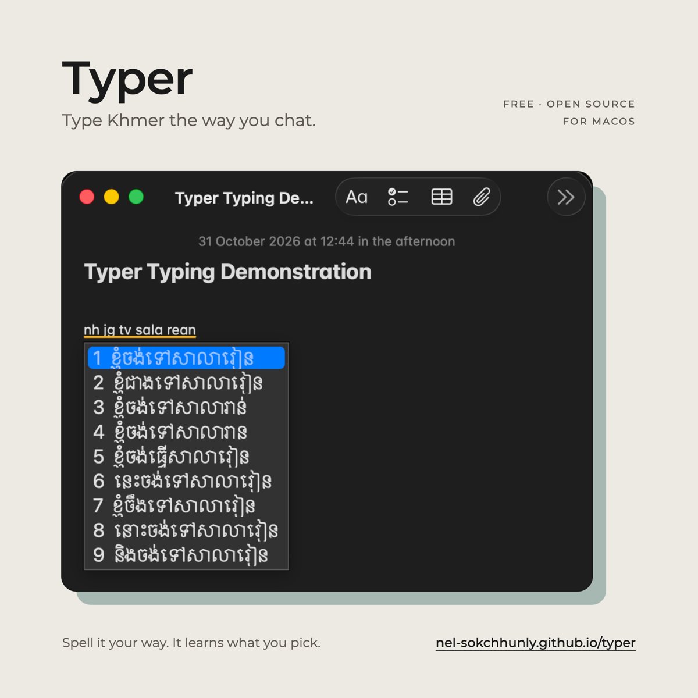

# Typer



**Illustrated install guide with screenshots: <https://nel-sokchhunly.github.io/typer/>**

Typer lets you type Khmer the way you already chat in Latin letters (Sing Khmer):

```
knhom tov sala rean   →   ខ្ញុំទៅសាលារៀន
anh ot jg tv teas te  →   អញអត់ចង់ទៅផ្ទះទេ
```

It works in any app: Messenger, Telegram, Notes, browsers, and so on.

**Requirements:** macOS 13 (Ventura) or newer, on an Apple Silicon or Intel Mac.

> Typer is an early preview. Expect wrong suggestions sometimes. It learns from what you pick, so it gets better the more you use it.

## Install on macOS

### 1. Download and install

Open **Terminal** (press `⌘ Space`, type *Terminal*, press Enter), then paste these lines and press Enter:

```sh
curl -fsSL -o /tmp/Typer-macos.zip https://github.com/Nel-sokchhunly/typer/releases/latest/download/Typer-macos.zip
mkdir -p ~/Library/Input\ Methods
rm -rf ~/Library/Input\ Methods/Typer.app
ditto -x -k /tmp/Typer-macos.zip ~/Library/Input\ Methods/
xattr -dr com.apple.quarantine ~/Library/Input\ Methods/Typer.app
echo "Typer installed"
```

Got the zip from a friend or the [Releases page](https://github.com/Nel-sokchhunly/typer/releases) instead? Put it in Downloads and run:

```sh
cd ~/Downloads
unzip -o Typer-macos.zip
xattr -dr com.apple.quarantine Typer.app
mkdir -p ~/Library/Input\ Methods
rm -rf ~/Library/Input\ Methods/Typer.app
mv Typer.app ~/Library/Input\ Methods/
```

> **Why the `xattr` line?** Typer isn't signed with a paid Apple Developer certificate yet, so macOS blocks it by default when it comes from the internet. This line removes that block for Typer only. Only run it if you trust where you got the zip.

### 2. Turn it on

1. Open **System Settings → Keyboard**.
2. Under **Text Input**, click **Edit…** next to *Input Sources*.
3. Click **+** at the bottom left, choose **Khmer** in the list, select **Typer**, and click **Add**.

If Typer isn't in the list, **log out and log back in** (Apple menu → Log Out), then try again.

### 3. Use it

Switch to Typer with **`Ctrl Space`** or the **🌐 Globe** key. You can also pick it from the input menu in the menu bar.

Type Khmer in Latin letters, with spaces between words. A list of suggestions appears under your text.

| Key | What it does |
|---|---|
| `↓` / `↑` or `Tab` / `Shift Tab` | Move through the suggestions (wraps around) |
| `Enter` | Insert the highlighted suggestion (the first one unless you moved) |
| `1` to `9` | Insert that suggestion |
| Click | Insert the clicked suggestion |
| `Esc` | Insert exactly what you typed, in Latin letters |
| `Delete` | Edit what you're typing |
| `.` `,` `?` and other punctuation | Insert the first suggestion, then the punctuation |
| Tap `Shift` on its own | Switch between Khmer and English. A small **ខ** / **EN** badge shows the mode |

**Tips**

- Spell words however you normally do. `knhom`, `knh` and `nh` all work for ខ្ញុំ.
- When the right answer isn't first, pick it with a number. Typer remembers it and ranks it higher next time.
- To type English, tap `Shift` once. Your keys then go straight through as normal English. Tap `Shift` again to go back to Khmer. Holding `Shift` to type a capital letter does not switch modes.
- If you tap `Shift` in the middle of a phrase, what you typed so far is kept in Latin letters.

## Privacy

Everything stays on your Mac. Typer has no network access and sends nothing anywhere.

What you pick is saved locally so Typer can learn:

```
~/Library/Application Support/Typer/
  user.tsv    words and word pairs you've picked
  picks.tsv   what you typed → what you chose
```

Delete that folder at any time to reset what Typer has learned.

## Update

Run the install command from **step 1** again. What Typer has learned is kept. If it still behaves like the old version, switch to another input source and back, or log out and back in.

## Uninstall

1. Remove Typer from **System Settings → Keyboard → Input Sources**.
2. Run this in Terminal:

```sh
rm -rf ~/Library/Input\ Methods/Typer.app ~/Library/Application\ Support/Typer
```

## Problems?

- **No suggestions appear:** make sure Typer is the selected input source (check the menu bar). You may be in English mode; tap `Shift` once.
- **"Typer can't be opened" or nothing happens:** run the `xattr` line from step 1 again, then log out and back in.
- **Old icon in the Globe switcher or menu bar:** run `killall -9 TextInputSwitcher TextInputMenuAgent` in Terminal (macOS restarts them), or log out and back in.
- **Bad suggestion:** please report what you typed and what you expected at <https://github.com/Nel-sokchhunly/typer/issues>. These reports are how the engine improves.

## Development

Sing Khmer input engine: `knhom tov sala rean` → `ខ្ញុំទៅសាលារៀន`.

```
python3 data/build.py                                  # raw sources -> data/out/{lexicon,ngrams}.tsv
cd engine && cargo test --release                      # unit + real-data check
cd .. && engine/target/release/typer "knhom tov sala rean"
engine/target/release/typer                            # REPL; type a number after a phrase to pick/learn it
engine/target/release/typer eval eval/test.tsv         # top-1 / top-3 accuracy
```

Score per phrase = trigram LM (stupid backoff) − `SPELL_WEIGHT` × weighted edit distance(typed, spelling).
Tunables live at the top of `engine/src/lib.rs`.

User learning: picks append 1-3 gram counts to `$TYPER_USER/user.tsv` (default `data/user/`, boosted ×100 over corpus counts)
and log `typed<TAB>chosen` to `picks.tsv`. C ABI for frontends: `engine/typer.h`.

### macOS input method

```
macos/build.sh install     # build build/Typer.app for this Mac, copy to ~/Library/Input Methods
macos/build.sh dist        # universal build/Typer-macos.zip (local check; CI builds releases)
```
Release: `git tag v0.1.1 && git push origin v0.1.1`. CI (`.github/workflows/ci.yml`) tests, builds the universal zip and publishes the GitHub release.

Then System Settings → Keyboard → Input Sources → Edit → + → Khmer → **Typer**. Switch with Ctrl-Space / Globe.

Type `knhom tov sala rean`: ↓/↑ or Tab = move highlight, Enter = insert highlighted, 1-9 = pick, Esc = keep latin, Delete = edit,
tap Shift alone = toggle English passthrough.
Picks are learned into `~/Library/Application Support/Typer/` (`user.tsv`, `picks.tsv`).
After a rebuild, `install` restarts the input method; if it still looks stale, switch input source away and back.

### Data credits

- `data/raw/mobile-keyboard-data.json`: shared open Khmer/English keyboard n-gram data.
- `data/raw/hand-romans.txt`: from [khmer-text-transliteration](https://github.com/Chhunneng/khmer-text-transliteration),
  MIT License, Copyright (c) 2025 Chrea Chanchhunneng.
