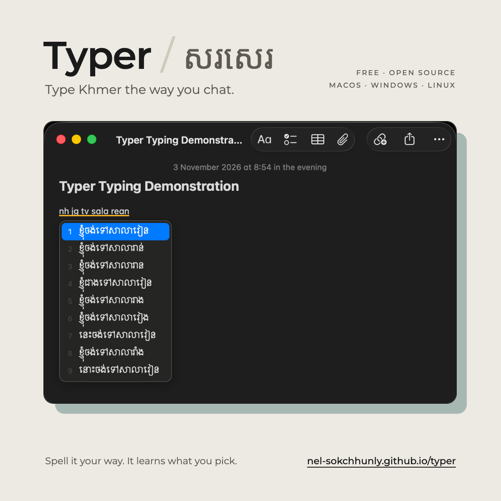

# Typer / សរសេរ



**Illustrated install guide with screenshots: <https://nel-sokchhunly.github.io/typer/>**

Typer lets you type Khmer the way you already chat in Latin letters (Sing Khmer):

```
knhom tov sala rean   →   ខ្ញុំទៅសាលារៀន
anh ot jg tv teas te  →   អញអត់ចង់ទៅផ្ទះទេ
```

It works in any app: Messenger, Telegram, Notes, browsers, and so on.

**Requirements:** macOS 13 (Ventura) or newer on an Apple Silicon or Intel Mac, Windows 10 / 11 (64-bit), or Ubuntu 22.04+ / Debian 12+ with IBus.

> Typer is an early preview. Expect wrong suggestions sometimes. It learns from what you pick, so it gets better the more you use it.

**Contents:** [Install](#install) ([macOS](#macos) · [Windows](#windows) · [Linux](#linux) · [Android](#android-preview)) · [Use it](#use-it) · [Settings](#settings) · [Privacy](#privacy) · [Update](#update) · [Uninstall](#uninstall) · [Problems?](#problems) · [Development](#development)

## Install

### macOS

**1. Download and install**

Download **[Typer.pkg](https://github.com/Nel-sokchhunly/typer/releases/latest/download/Typer.pkg)**, double-click it in Downloads, and click through the installer.

> **macOS says it can't verify Typer?** Typer isn't signed with a paid Apple Developer certificate yet. Open **System Settings → Privacy & Security**, scroll down, click **Open Anyway** next to Typer.pkg, then confirm. On macOS 13 or 14 you can also Control-click Typer.pkg and choose **Open**. Only do this if you got the file from this repo.

**Or with Terminal:** open **Terminal** (press `⌘ Space`, type *Terminal*, press Enter), then paste these lines and press Enter:

```sh
curl -fsSL -o /tmp/Typer-macos.zip https://github.com/Nel-sokchhunly/typer/releases/latest/download/Typer-macos.zip
mkdir -p ~/Library/Input\ Methods
rm -rf ~/Library/Input\ Methods/Typer.app
ditto -x -k /tmp/Typer-macos.zip ~/Library/Input\ Methods/
xattr -dr com.apple.quarantine ~/Library/Input\ Methods/Typer.app
echo "Typer installed"
```

Got the zip from a friend or the [Releases page](https://github.com/Nel-sokchhunly/typer/releases) instead? Put it in Downloads and run:

```sh
cd ~/Downloads
unzip -o Typer-macos.zip
xattr -dr com.apple.quarantine Typer.app
mkdir -p ~/Library/Input\ Methods
rm -rf ~/Library/Input\ Methods/Typer.app
mv Typer.app ~/Library/Input\ Methods/
```

> **Why the `xattr` line?** Typer isn't signed with a paid Apple Developer certificate yet, so macOS blocks it by default when it comes from the internet. This line removes that block for Typer only. Only run it if you trust where you got the zip.

**2. Turn it on**

1. Open **System Settings → Keyboard**.
2. Under **Text Input**, click **Edit…** next to *Input Sources*.
3. Click **+** at the bottom left, choose **Khmer** in the list, select **Typer / សរសេរ**, and click **Add**.

If Typer isn't in the list, **log out and log back in** (Apple menu → Log Out), then try again.

### Windows

1. Download **[Typer-windows-setup.exe](https://github.com/Nel-sokchhunly/typer/releases/latest/download/Typer-windows-setup.exe)** and double-click it.
2. If Windows shows *"Windows protected your PC"*, click **More info → Run anyway**. Typer isn't signed with a paid certificate yet.
3. Click **Install**, then **Finish**.

### Linux

Ubuntu 22.04+ or Debian 12+ (64-bit Intel/AMD) with IBus, the default on GNOME. Fcitx5 (common on KDE) isn't supported yet.

1. Download **[Typer-linux-amd64.deb](https://github.com/Nel-sokchhunly/typer/releases/latest/download/Typer-linux-amd64.deb)** and open it to install, or run `sudo apt install ./Typer-linux-amd64.deb`.
2. Log out and back in (IBus only finds new input methods when it starts).
3. Open **Settings → Keyboard → Input Sources → + → Khmer → Typer / សរសេរ**.

### Android (preview)

Android 7.0 or newer. There is no Play Store listing yet: you install the app file yourself (sideload).

1. Get **app-debug.apk**: open the latest successful run of the `ci` workflow on the [Actions page](https://github.com/Nel-sokchhunly/typer/actions/workflows/ci.yml), download the **typer-android-debug** artifact (sign in to GitHub first) and unzip it. Or build it yourself with `android/build.sh` (see `android/README.md`).
2. Open the file on your phone. Android asks to allow installs from that app (your browser or file manager): allow it, then tap **Install**. The file is signed with a debug key, so Play Protect may warn about an unknown developer; only continue if you got the file from this repo.
3. Open **សរសេរ (Typer)** from your apps and follow its two setup steps: **Open Settings** to turn on Typer (Android warns that any keyboard can collect what you type; Typer has no internet access and keeps everything on the phone), then **Choose keyboard** to pick Typer (សរសេរ).
4. Try it in the app's test field: type `knhom` and tap **ខ្ញុំ**.

To update: preview builds are signed with a different debug key each time, so Android refuses to install one over another. Uninstall the old app first (long-press the icon, **Uninstall**), then install the new file; this also clears what Typer has learned on the phone.

## Use it

Switch to Typer:

- **macOS:** `Ctrl Space` or the **🌐 Globe** key, or pick it from the input menu in the menu bar.
- **Windows:** `Windows Space`, then choose **Typer / សរសេរ**.
- **Linux:** `Super Space`.

Type Khmer in Latin letters, with spaces between words. Type the whole phrase: a list of suggestions appears under your text, and the first one is usually the whole phrase in Khmer.

```
knhom tov sala rean   →   ខ្ញុំទៅសាលារៀន
```

| Key | What it does |
|---|---|
| `Space` | Separate words. It never inserts anything, so keep typing |
| `↓` / `↑` or `Tab` / `Shift Tab` | Move through the suggestions (wraps around) |
| `Enter` | Insert the highlighted suggestion (the first one unless you moved) |
| `1` to `9`, or click | Insert that suggestion |
| `.` `,` `?` and other symbols | Stay in the phrase as typed: `knhom, tov te?` suggests **ខ្ញុំ, ទៅទេ?** |
| `Esc` | Insert exactly what you typed, in Latin letters |
| `Delete` (`Backspace` on Windows / Linux) | Edit what you're typing |
| Tap `Ctrl` on its own, with nothing typed | Switch between Khmer and English |

**Khmer or English?** A small yellow **ខ** or **EN** badge under the cursor shows the mode. It hides while you type and comes back when you pause for a second. It goes away when you leave a text field. In English mode your keys go straight to the app as normal English. Tap `Ctrl` again to go back to Khmer. Shortcuts like `Ctrl C` don't switch modes. On Linux the badge shows for a moment when you switch; the top bar shows the mode the rest of the time.

**Tips**

- Spell words however you normally do. `knhom`, `knh` and `nh` all work for ខ្ញុំ.
- When the right answer isn't first, pick it with a number. Typer remembers it and ranks it higher next time.
- English words mix in: `thank you bong` suggests **thank you បង**. Words that are also common Khmer spellings (`mean` = មាន) stay Khmer first, with the English further down the list.
- `te` closing a negative becomes ទេ, however long the sentence: `ot mean luy te` suggests **អត់មានលុយទេ**.
- For a word exactly as typed in Latin letters, type it and press `Esc`. You stay in Khmer.

**Platform differences**

- **Windows:** picking with the mouse isn't supported yet; use `Enter` or `1` to `9`.

## Settings

New in 0.4.0. Open **Typer Settings** to switch features on or off. Everything is on by default, and changes apply on your next keystroke.

- **macOS:** click the input menu in the menu bar, then **Typer Settings…**
- **Windows:** Start menu → **Typer Settings**, or **Settings → Time & language → Language & region → Khmer → Typer → Options**.
- **Linux:** the keyboard menu in the top bar → **Typer Settings…**, **Settings → Keyboard → Input Sources → Typer → Preferences**, or open **Typer Settings** from your apps.

| Switch | What it does |
|---|---|
| Extra words | Suggest words whose Latin spelling Typer guessed by rule (`zin` → ហ្សីន). They always rank below known words. |
| English words | Mix English into suggestions: `thank you bong` → **thank you បង** |
| Learn from my picks | Rank what you pick higher next time. Off: nothing new is saved. |
| Mode badge | Show the ខ / EN badge under the cursor |

## Privacy

Everything stays on your computer. Typer has no network access and sends nothing anywhere.

What you pick is saved locally so Typer can learn:

| Platform | Folder |
|---|---|
| macOS | `~/Library/Application Support/Typer/` |
| Windows | `%APPDATA%\Typer` |
| Linux | `~/.local/share/typer/` |

```
user.tsv      words and word pairs you've picked
picks.tsv     what you typed → what you chose
settings.txt  your Typer Settings switches
```

To stop saving picks, switch off **Learn from my picks** in [Typer Settings](#settings).

Delete that folder at any time to reset what Typer has learned.

## Update

Download and run the installer again (on a Mac you can also run the Terminal commands from [install](#macos) again). What Typer has learned is kept. If it still behaves like the old version, switch to another input source and back, or log out and back in. On Windows, apps that were open during the update switch to the new version after a restart.

## Uninstall

- **macOS:** remove Typer from **System Settings → Keyboard → Input Sources**, then run this in Terminal:

  ```sh
  rm -rf ~/Library/Input\ Methods/Typer.app ~/Library/Application\ Support/Typer
  ```

- **Windows:** **Settings → Apps → Installed apps → Typer → Uninstall**.
- **Linux:** `sudo apt remove typer`, and remove Typer from **Input Sources**.

## Problems?

- **No suggestions appear:** make sure Typer is the selected input source (check the menu bar). You may be in English mode; tap `Ctrl` once.
- **macOS: "Typer can't be opened" or nothing happens:** run the `xattr` line from [the macOS install](#macos) again, then log out and back in.
- **macOS: old icon in the Globe switcher or menu bar:** run `killall -9 TextInputSwitcher TextInputMenuAgent` in Terminal (macOS restarts them), or log out and back in.
- **Bad suggestion:** please report what you typed and what you expected at <https://github.com/Nel-sokchhunly/typer/issues>. These reports are how the engine improves.

## Development

Sing Khmer input engine: `knhom tov sala rean` → `ខ្ញុំទៅសាលារៀន`.

```
python3 data/build.py                                  # raw sources -> data/out/{lexicon,generated,ngrams,english}.tsv
python3 -I data/romanize.py                            # score the rule-based speller; or pass Khmer words to see spellings
cd engine && cargo test --release                      # unit + real-data check
cd .. && engine/target/release/typer "knhom tov sala rean"
engine/target/release/typer                            # REPL; type a number after a phrase to pick/learn it
engine/target/release/typer eval eval/test.tsv         # top-1 / top-3 accuracy
```

Score per phrase = trigram LM (stupid backoff) − `SPELL_WEIGHT` × weighted edit distance(typed, spelling).
Tunables live at the top of `engine/src/lib.rs`.

User learning: picks append 1-3 gram counts to `$TYPER_USER/user.tsv` (default `data/user/`, boosted ×100 over corpus counts)
and log `typed<TAB>chosen` to `picks.tsv`. C ABI for frontends: `engine/typer.h`.

New words: add Khmer words one per line to `data/raw/words.txt` (no spelling needed): `data/romanize.py` guesses their
chat spellings into `data/out/generated.tsv`, ranked below every known word. Words with a known spelling go in
`data/raw/user-romans.txt` as `ខ្មែរ=khmer,kmer` instead.

Settings: `settings.txt` in the user folder holds `name=on|off` switches (`engine::SETTINGS`), re-read when it changes.
`settings/` is the Typer Settings app (Tauri) that edits it; each platform build bundles it
(Linux build needs `libwebkit2gtk-4.1-dev libgtk-3-dev`).

### macOS input method

```
macos/build.sh install     # build build/Typer.app for this Mac, copy to ~/Library/Input Methods
macos/build.sh dist        # universal build/Typer-macos.zip (local check; CI builds releases)
```
Release: `git tag v0.1.1 && git push origin v0.1.1`. CI (`.github/workflows/ci.yml`) tests, builds the macOS pkg + zip and the Windows installer, and publishes the GitHub release.

Then System Settings → Keyboard → Input Sources → Edit → + → Khmer → **Typer / សរសេរ**. Switch with Ctrl-Space / Globe.

Type `knhom tov sala rean`: ↓/↑ or Tab/Shift-Tab = move highlight, Enter = insert highlighted, 1-9 = pick, Esc = keep latin, Delete = edit, symbols join the phrase,
tap Ctrl alone (nothing typed) = toggle English passthrough.
Picks are learned into `~/Library/Application Support/Typer/` (`user.tsv`, `picks.tsv`).
After a rebuild, `install` restarts the input method; if it still looks stale, switch input source away and back.

### Windows input method

`windows/` is a TSF text service (COM DLL, Rust + `windows` crate) over the same engine; `windows/installer.iss` is the Inno Setup wizard.
CI builds the x64 + x86 DLLs on every push and, on tags, `Typer-windows-setup.exe` for the release.
From a Mac you can type-check it: `rustup target add x86_64-pc-windows-msvc && cargo check --manifest-path windows/Cargo.toml --target x86_64-pc-windows-msvc`.
Typer Settings is installed next to the DLLs; Windows Settings' **Options** button for Typer opens it (`ITfFnConfigure`).

### Linux input method

`linux/ibus-typer.c` is an IBus engine over the engine's C ABI; IBus draws the candidate window. `linux/build.sh deb` builds
`build/Typer-linux-<arch>.deb` (needs `libibus-1.0-dev`); `linux/test_ibus.py` drives the installed engine through a real
`ibus-daemon`. CI builds and tests it on Ubuntu 22.04 on every push and attaches the .deb to releases. From a Mac, Docker works:
an `ubuntu:22.04` container with `build-essential pkg-config libibus-1.0-dev python3 dpkg-dev` and rustup.

### Data credits

- `data/raw/mobile-keyboard-data.json`: shared open Khmer/English keyboard n-gram data.
- `data/raw/hand-romans.txt`: from [khmer-text-transliteration](https://github.com/Chhunneng/khmer-text-transliteration),
  MIT License, Copyright (c) 2025 Chrea Chanchhunneng.

## License

MIT, see [LICENSE](LICENSE). Bundled data keeps its own credits above.
